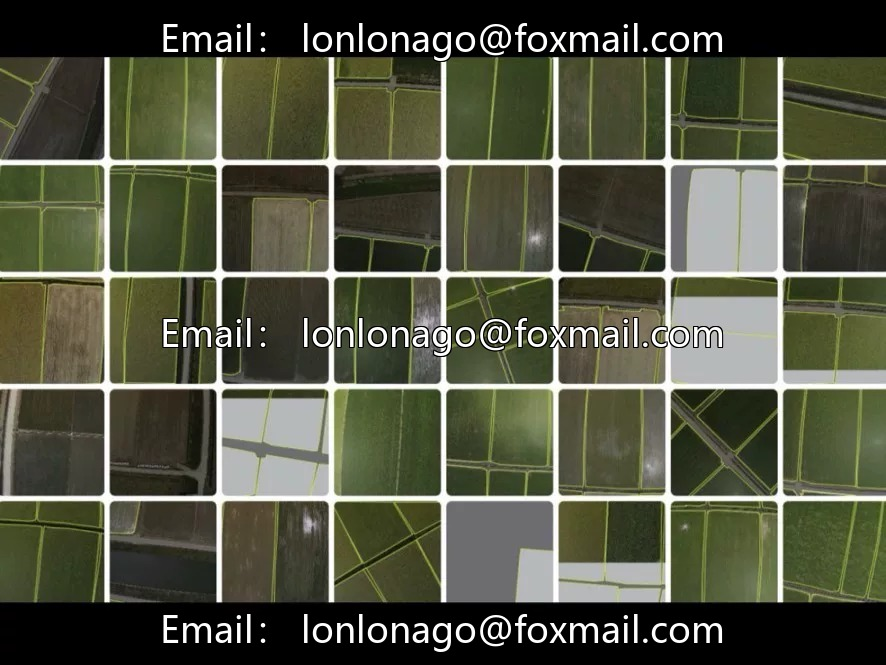
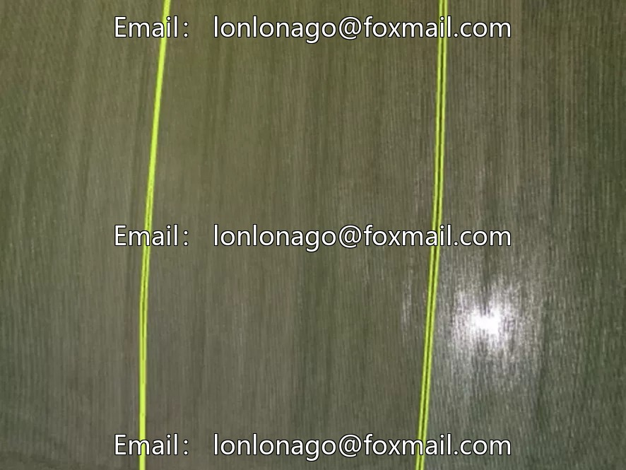
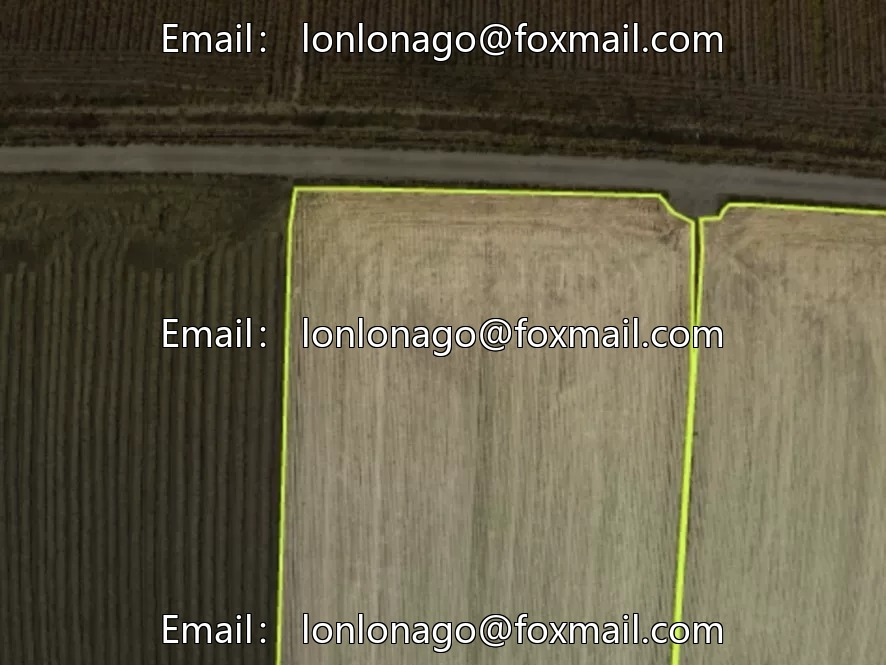
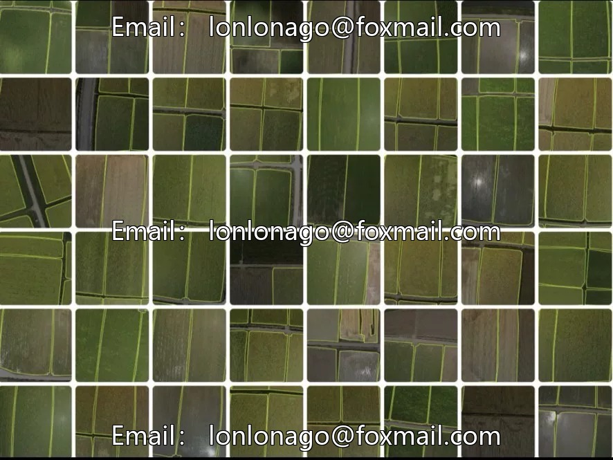
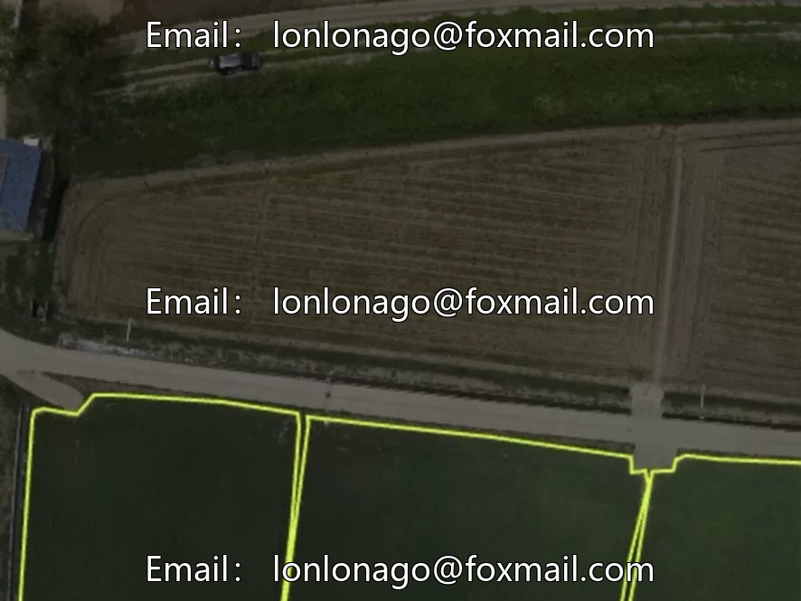
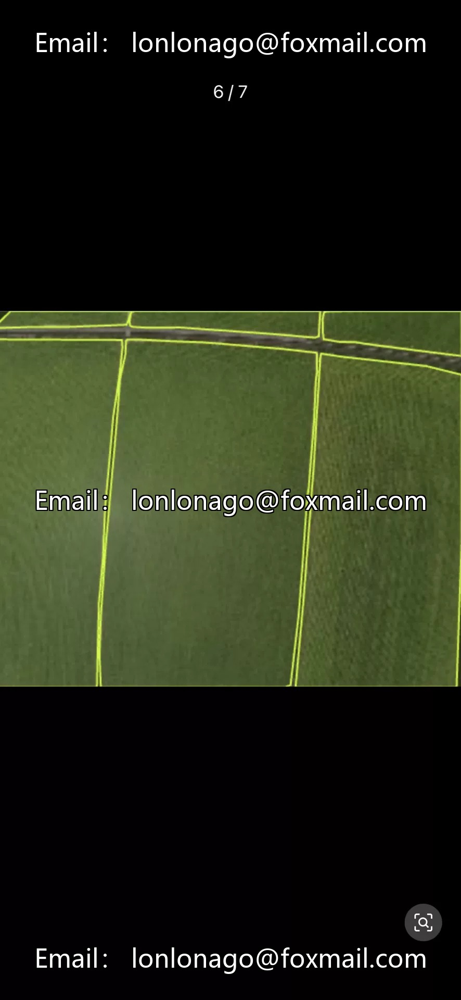

# Drone Cropland Segmentation Dataset

## Body

Drone Crop Segmentation Dataset - 10685th Issue, comprising 5000 high-resolution aerial images of drones. Two core targets: farmland and another category (specified in the annotation file; suspected water bodies or other surface cover).

The dataset is for instance segmentation tasks, supporting YOLO, VOC, COCO three mainstream formats for annotation. It is compatible with mainstream segmentation frameworks such as YOLOv8-seg and Mask R-CNN. The images cover different lighting and seasonal backgrounds, demonstrating strong generalization capabilities. It is recommended to use data augmentation strategies like random flipping and brightness adjustment in conjunction.

Applicable to precision agriculture planning, land resource monitoring, water resources supervision, disaster risk assessment, etc. The segmentation results can be used for in-depth applications such as cropland boundary extraction, area measurement, and crop planting structure analysis.

Virtual materials, once sold, are non-refundable.
Interested friends, click "I want" to proceed.

## Images

## Payment

Here is a pay link on Stripe ( https://buy.stripe.com/3cs8yP7sY87d0vu9AB ). Please contact me lonlonago@foxmail.com after funding $89, and I will send you a complete data files , thank you!

